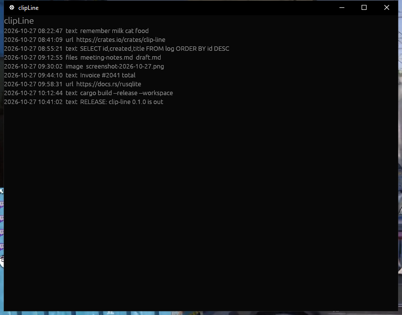

# clipLine

[](../../actions/workflows/ci.yml)
[](#license)

clipLine is a local clipboard history manager written in Rust. It includes a
history and snippets interface, clipboard capture and paste adapters, and a
SQLite store designed for compatibility with ClipDiary. This parity work is
still in progress; see the limitations below before relying on it.



## Features

- Search, filter, star, tag and delete clipboard history; save snippets in folders.
- Capture clipboard changes on Windows, X11, supported Wayland compositors and macOS.
- Paste or copy a selected clip; Wayland uses manual paste.
- Open a ClipDiary history database or import a history into a separate database.
- Optional capture exclusions, clear on exit, secure-delete, autostart, and release checks.
- Optional SQLCipher support for new encrypted databases when built with the
  `encryption` feature.

Native format support varies by platform. The adapters support text, images
and file drops, subject to platform format limitations. The
original application's ability to read files written by clipLine requires
manual verification on a real ClipDiary installation. See `docs/interop.md`.

## Build and run

Install Rust 1.95 or newer and the desktop development libraries needed by
`eframe` and the platform adapters. On Linux use an X11 session with XFixes and
XTest, or Wayland with `ext-data-control` or `wlr-data-control` support. On
macOS, paste injection requires Accessibility permission.

```sh
cargo build --workspace
cargo run -p clip-line-app
cargo run -p clip-line-app --bin clip-line-headless
```

To create or open an SQLCipher database, build and start with:

```sh
cargo run -p clip-line-app --features encryption -- --encrypted
```

The password is requested in the terminal and is not saved in the config. Use a
new database path; this option does not convert an existing plaintext database.
The snippets database uses the same key. Encrypted databases currently require
this terminal prompt on each launch and cannot be unlocked through autostart.
Back up data before changing storage.

To import an unlocked legacy history into the configured database, run
`clip-line-app --import-db /path/to/diary.db`. Existing rows with conflicting IDs
are skipped. Add `--encrypted` for an encrypted destination.

To import supported legacy hotkey entries, run:

```sh
clip-line-app --import-ini /path/to/clipdiary.cfg
```

The decoded entries are saved in the TOML config; choose
the show binding manually, since the legacy slot mapping is not verified.

By default the database and configuration are in the user's configuration
directory. Set `CLIP_LINE_DB` to use a different database path. Opening an
existing ClipDiary database in place should be done only when ClipDiary is
closed; import a copy if both programs need independent histories.

## Configuration

Edit `clipline.toml` in the application configuration directory. For example:

```toml
[hotkeys]
show = "Ctrl+Shift+Up"

[paste]
default_mode = "inject_ctrl_v" # set_only | inject_ctrl_v | type_in

[ui]
hide_after_ms = 1200

[autostart]
enabled = false

[updates]
enabled = false # optional GitHub Releases check; no automatic installation

[capture]
exclude_apps = ["password-manager.exe"]
exclude_formats = ["dib", "dibv5"]
max_bytes = 10485760

[privacy]
clear_on_exit = false
secure_delete = false
```

Exclusion rules reject an entire clipboard event; application names are exact,
case-insensitive matches, and the size limit covers all its captured formats.
When app exclusions are configured, events without an identified source are
rejected. Source identification is platform-dependent and may be inaccurate;
Wayland currently cannot identify the source, so app exclusions disable capture
there. Do not rely on these rules as the sole protection for sensitive copies. Secure deletion asks SQLite to overwrite deleted database pages; WAL
files, filesystem snapshots, backups and storage hardware can retain data.
Clear-on-exit applies to history, not snippets, and requires a normal shutdown.

## Development

```sh
cargo test --workspace
cargo clippy --workspace -- -D warnings
cargo fmt --check
```

Headless tests do not replace desktop testing. Check capture, paste, focus,
hotkeys, tray, file and image formats on each target OS, and check the shared
database with a portable ClipDiary installation after changes to writes.

## Limitations

- Platform feature parity and desktop smoke testing are not yet complete.
  Caret-positioned popups are Windows-only. X11 paste injection and type-in are disabled in the app until focus can be
  verified, and Wayland source-app identification is not yet available. X11
  paste offers one representation per clip; macOS does not capture arbitrary
  rich formats and supports common RGB image layouts only.
- Linux tray support requires a StatusNotifier host and session D-Bus.
- Some Wayland compositors do not expose a data-control protocol; capture is
  unavailable there. Wayland paste injection is not supported.
- Clipboard managers and original ClipDiary database versions can behave
  differently; keep a backup before using an existing history.
- SQLCipher and ClipDiary's legacy encrypted databases are different formats;
  legacy locked databases cannot be opened directly.

See [CONTRIBUTING.md](CONTRIBUTING.md) for contribution information.

## License

[MIT](LICENSE). clipLine is not affiliated with Softvoile ClipDiary.
